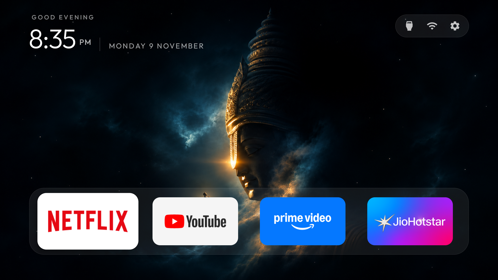
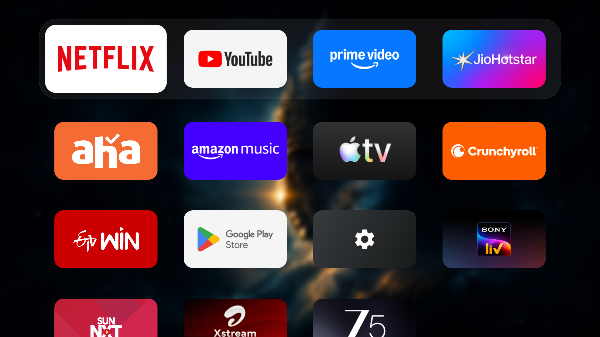
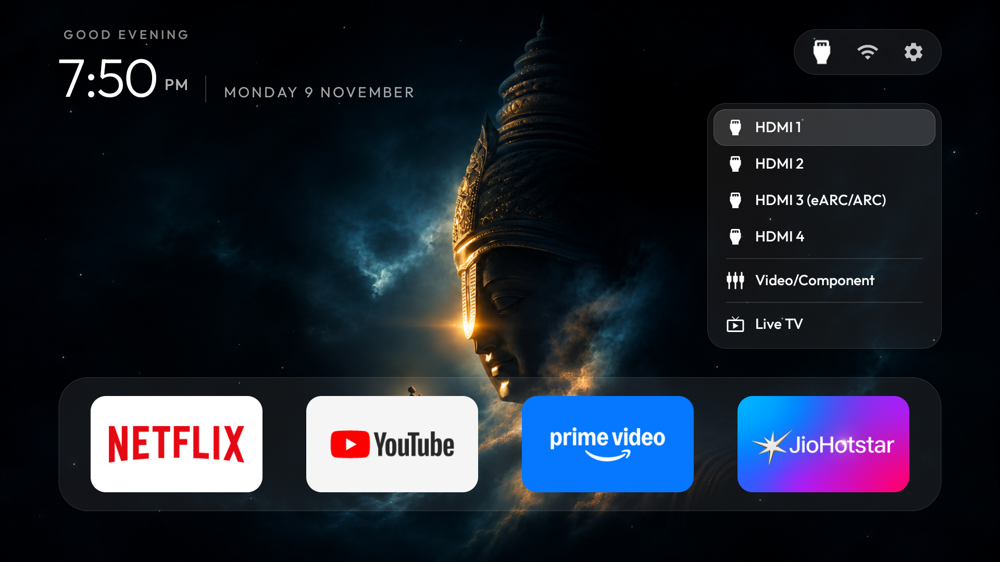

# Apple TV Launcher for Android TV & Google TV

[](LICENSE)
[-green.svg)](launcher/app/build.gradle)
[](launcher/app/src/main/AndroidManifest.xml)
[](CONTRIBUTING.md)

An ad-free, ultra-lightweight, open-source Android TV / Google TV launcher (`com.ashwithkumar.tvhome`) modeled after Apple TV 4K — complete with automated AI coding agent setup, stock UI backup, and one-click restore tools.

---

## Screenshots

### Home Screen
Clean top-left greeting, clock, and date; frosted top-right **Inputs / Wi-Fi / Settings** pill container; custom wallpaper; and a frosted glass dock band at the bottom.



### App Screen
Press **Down** from the dock to reveal the blurred backdrop app grid pinned smoothly under the dock row, with deterministic D-pad navigation row by row.



### HDMI & Live TV Input Switcher
Selecting **Inputs** opens an animated glass dropdown aligned cleanly above the dock.



---

## Features

- **Apple TV-Style Dock & App Grid**: Frosted glass translucent dock band (`dock_glass`, `dock_border`, `dock_opacity`) supporting `4`, `5`, `6`, or `7` configurable columns and smooth focus scaling (`glass_style=none`).
- **Top Control Bar**: Rounded frosted pill bar containing **Inputs** (HDMI / AV / Live TV popup switcher), **Wi-Fi** (opens TV network settings), and **Settings**.
- **Built-in Screensaver (`ClockActivity`)**: Starts automatically after inactivity (3 minutes default) or when pressing **Back** on the Home screen, displaying your personal screensaver image with a top-right clock & date.
- **Included Wallpaper**: Ships [`wallpaper.png`](wallpaper.png) and automatically pushes it onto the TV during installation.
- **Private by Design**: Zero `INTERNET` permission, zero analytics, zero ads, zero background polling, release APK under 576 KB (`589,824 B`).
- **Safe & Reversible**: Backs up your stock UI, package lists, props, and settings first, and generates scripts to restore your stock launcher anytime.

---

## Quick Start with Any AI Coding Agent

Compatible out of the box with **Antigravity**, **Codex**, **Claude Code**, **Gemini CLI**, and **Cursor** (all read [`AGENTS.md`](AGENTS.md)).

### 1. Enable ADB Debugging on Your TV
On your Android TV / Google TV:
1. Open **Settings → Device Preferences → About** and press **OK** on **Build** 7 times.
2. Go back to **Developer options** and enable **USB debugging** (and **Network / ADB debugging** if available).
3. Find your TV's IP address under **Settings → Network & Internet**.

### 2. Clone & Run with Your Coding Agent
```bash
git clone https://github.com/Ashwithkumar-1827/Apple-TV.git
cd Apple-TV
```

Open the folder in your AI coding agent and say:

> **"Run this repo and install the launcher on my TV."**

*(Or paste [`PROMPT.md`](PROMPT.md).)*

### What the Agent Does Automatically
1. **Connects over ADB** using [`tools/tv.py`](tools/tv.py) and checks TV compatibility (`SDK >= 26`).
2. **Backs up your current stock UI & packages first** into `backup/` and creates your custom `restore-stock.sh` / `restore-stock.ps1`.
3. **Inspects your installed TV apps and asks you before building**:
   - How many **columns / dock apps** (`N`) you want (`4`, `5`, `6`, or `7`).
   - Which **exact `N` apps** you want in the dock and their order.
   - A local **photo for your screensaver** (never committed or pushed to GitHub).
   - Whether you want optional safe debloating (`pm disable-user` only, never `pm uninstall`).
4. **Builds & installs** the launcher via [`launcher/build-and-install.sh`](launcher/build-and-install.sh) or [`launcher/build-and-install.ps1`](launcher/build-and-install.ps1), pushes [`wallpaper.png`](wallpaper.png) and your screensaver image, verifies with live TV screenshots, and reminds you to turn off ADB debugging when done.

---

## Manual Build & Installation

### Prerequisites
- **Computer**: Python 3.10+, JDK 17+, Android SDK Platform 34.
- **TV**: Android TV / Google TV (`SDK >= 26`, Android 8.0+). *(Does not apply to Samsung Tizen, LG webOS, Roku OS, VIDAA, or Fire OS 5.)*

### Setup & Install
1. Install Python dependencies:
   ```bash
   python3 -m venv tools/venv
   tools/venv/bin/pip install -r tools/requirements.txt
   ```
   *(Windows PowerShell: `python -m venv tools\venv; tools\venv\Scripts\pip install -r tools\requirements.txt`)*

2. Customize columns and dock apps in [`launcher/app/src/main/res/values/config.xml`](launcher/app/src/main/res/values/config.xml).

3. *(Optional)* Place your local `screensaver.png` or `screensaver.jpg` in the repo root (gitignored automatically).

4. Build, install, and push wallpaper/screensaver:
   - **macOS / Linux**:
     ```bash
     TV_HOST=<tv-ip> launcher/build-and-install.sh
     ```
   - **Windows (PowerShell)**:
     ```powershell
     launcher\build-and-install.ps1 -TvHost <tv-ip>
     ```

---

## Restoring Stock TV UI

Everything is reversible. To restore your original launcher and re-enable any disabled apps at any time:
- Run the generated restore script inside `backup/` (`restore-stock.ps1` / `restore-stock.sh`), or
- Use `tools/restore.sh` / `tools/restore.ps1`.

---

## Repository Layout

```text
Apple-TV/
├── AGENTS.md                 # Automated agent setup & safety workflow
├── CLAUDE.md / GEMINI.md     # Agent entry points importing AGENTS.md
├── PROMPT.md                 # Paste-ready prompt for coding agents
├── CONTRIBUTING.md           # Contribution guidelines & APK size budget
├── CODE_OF_CONDUCT.md        # Community guidelines
├── LICENSE                   # MIT License
├── wallpaper.png             # Default home screen wallpaper
├── assets/                   # README showcase screenshots
├── launcher/                 # Android TV launcher Gradle project (Java)
│   ├── build-and-install.sh
│   └── build-and-install.ps1
└── tools/                    # Python/Shell/PowerShell ADB & backup tools
```

---

## Privacy & Git Hygiene

[`.gitignore`](.gitignore) excludes `backup/`, `shots/`, `work/`, `tools/venv/`, `tools/adbkey/`, build outputs, and `screensaver.*` so personal photos, Wi-Fi SSIDs, IP addresses, and device serials are never committed.

## License & Credits

- Licensed under the **MIT License** — see [`LICENSE`](LICENSE).
- Maintained by **Madishetti Ashwith Kumar** ([Ashwithkumar-1827/Apple-TV](https://github.com/Ashwithkumar-1827/Apple-TV)) with Apple TV-inspired dock geometry, top control bar, animated HDMI input switcher, screensaver mode, and automated AI coding agent setup workflow.
